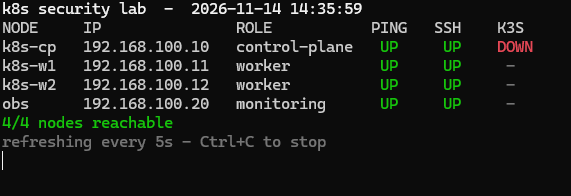

# k8s-security-lab

A home lab for **cloud-native (Kubernetes) security**: build a small cluster, harden it, enforce policy as code, secure the build pipeline, detect attacks at runtime, then attack it on purpose and measure what gets caught.

> **Status: Phase 1 (foundation) complete.** A 3-node k3s cluster (v1.37.2) runs on an isolated network, built with Ansible from a management host, with key-only SSH. Phase 2 (hardening) is next. This README only claims what is done. Later phases are listed as the plan.

## Why this lab
It covers the **workload layer** of cloud security: containers and Kubernetes. It complements my other projects:

| Layer | Project |
|---|---|
| Account activity (who did what) | [cloudtrail-sentinel](https://github.com/danielkosatka/cloudtrail-sentinel): AWS CloudTrail detection pipeline |
| Configuration (is it set up safely) | Dissertation: rule-based vs LLM detection of AWS misconfigurations |
| **Workloads (are the apps safe)** | **This lab** |

## Architecture
```
                 Windows host (VMware Workstation)
                 192.168.100.1  ── runs labcheck.py
                        │
        ════════════════╪════════════════  VMnet2: isolated host-only lab network
        │               │               │               │      192.168.100.0/24, no DHCP
   ┌─────────┐     ┌─────────┐     ┌─────────┐     ┌─────────┐
   │ k8s-cp  │     │ k8s-w1  │     │ k8s-w2  │     │   obs   │
   │  .10    │     │  .11    │     │  .12    │     │  .20    │
   │ control │     │ worker  │     │ worker  │     │ logging │
   │  plane  │     │         │     │         │     │ & alerts│
   └─────────┘     └─────────┘     └─────────┘     └─────────┘
   2 vCPU/4 GB     2 vCPU/4 GB     2 vCPU/4 GB     4 vCPU/8 GB

   Each VM also has a NAT adapter (ens33) for package updates only.
   OS: Ubuntu Server 26.04.1 LTS
```

## Roadmap
| Phase | What | Status |
|---|---|---|
| 1. Foundation | VMs, isolated network, SSH keys, Ansible, k3s | ✅ done ([notes](docs/phase-1-foundation.md)) |
| 2. Harden | kube-bench (CIS benchmark), RBAC, Pod Security Admission, default-deny NetworkPolicies | ⬜ planned |
| 3. Policy as code | Kyverno: no privileged pods, no `latest` tags, non-root, signed images only | ⬜ planned |
| 4. Secure pipeline | GitHub Actions: Trivy scans, Syft SBOM, cosign signing; Argo CD deploys | ⬜ planned |
| 5. Runtime detection | Falco with custom rules mapped to MITRE ATT&CK, alerts shipped to `obs` | ⬜ planned |
| 6. Attack and detect | Simulated attacks; table of attack → detection → gap | ⬜ planned |
| 7. Cloud (optional) | Same manifests on AWS EKS for a few hours via Terraform, then destroyed | ⬜ planned |

Phase 1 build notes, decisions and fixes: [docs/phase-1-foundation.md](docs/phase-1-foundation.md)

## Lab Check: connectivity dashboard
`scripts/labcheck.py` checks every node in parallel: **ping**, **SSH** (tcp/22) and the **Kubernetes API** (tcp/6443 on the control plane). Standard library only.



*End of Phase 1 networking: all 4 nodes up. K3S shows DOWN because k3s isn't installed yet.*

```bash
python scripts/labcheck.py              # check once
python scripts/labcheck.py --watch 5    # live dashboard, refresh every 5 s
python scripts/labcheck.py --require-k3s   # also fail if the k8s API is down
python scripts/labcheck.py --status-file status.md   # also write a Markdown table
```
It exits with code 1 if a required check fails, so it can be reused in CI.
On Windows, `scripts/make_shortcut.ps1` adds a desktop shortcut that opens the live dashboard.

## Repo layout
```
scripts/     labcheck.py, make_shortcut.ps1
ansible/     inventory, config, k3s.yml playbook
configs/     example config files (netplan, ssh)
docs/        build notes per phase, screenshots in docs/images/
assets/      icon for the desktop shortcut
```

## Security notes
- The lab network is **host-only**: nothing on it is reachable from my home network or the internet.
- **SSH is key-only**: password and root login are disabled on every node ([config](configs/ssh/10-hardening.conf)), using a dedicated passphrase-protected ed25519 lab key.
- Every cloned VM gets its **own SSH host keys and machine-id**. Clones otherwise share the template's keys, so one leaked key would let an attacker impersonate every node.
- No secrets in this repo: `.gitignore` blocks keys, kubeconfigs, the k3s join token and Terraform state.
