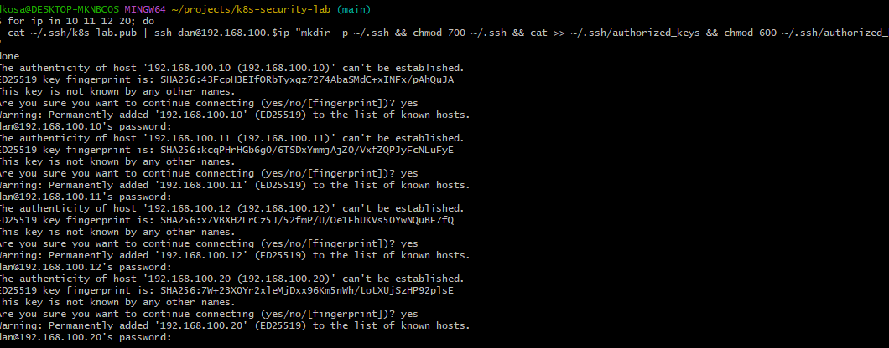
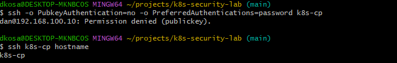

# Phase 1: Foundation

Goal: four Ubuntu VMs on an isolated network, reachable by SSH, ready for Ansible and k3s.

## Progress
- [x] Isolated host-only network (VMnet2, `192.168.100.0/24`, DHCP off)
- [x] Template VM: Ubuntu Server 26.04.1 LTS, updated, root disk extended, snapshot
- [x] 4 full clones, each with a unique hostname, machine-id, SSH host keys and static IP
- [x] `labcheck.py` confirms 4/4 nodes reachable (ping + SSH)
- [x] SSH key login, password login disabled
- [ ] Ansible inventory
- [ ] k3s installed, `kubectl get nodes` shows 3 nodes `Ready`

## Decisions
| Decision | Why |
|---|---|
| Ubuntu **Server** (not minimized, not desktop) | No GUI wasting RAM; minimized drops tools needed while learning |
| One template, then **full clones** | Faster than 4 installs, every node starts identical; full clones don't depend on the template |
| Two NICs per VM: NAT + host-only | NAT only for updates; cluster traffic stays on the isolated network |
| Static IPs, DHCP off on the lab network | Ansible and Kubernetes need fixed, predictable addresses |
| No disk encryption (LUKS) | Would need a passphrase typed at every boot and all clones would share the key. In a real cloud this is the provider's KMS |
| k3s before kubeadm | Lighter and quicker to get running; kubeadm rebuild is a stretch goal |

## Per-clone setup
A clone is an exact copy, so it starts with the template's identity. On each node:
```bash
sudo hostnamectl set-hostname <name>                     # new hostname
sudo sed -i 's/k8s-template/<name>/g' /etc/hosts         # fix local name lookup
sudo rm /etc/machine-id
sudo systemd-machine-id-setup                            # new machine-id
sudo rm /etc/ssh/ssh_host_*
sudo dpkg-reconfigure openssh-server                     # new SSH host keys
sudo sed -i '/match:/d;/macaddress:/d;/set-name:/d' /etc/netplan/00-installer-config.yaml
# then create /etc/netplan/60-lab.yaml (see configs/netplan/), chmod 600, netplan apply
```

## SSH: key-only access
1. Dedicated ed25519 key for the lab (`~/.ssh/k8s-lab`, passphrase-protected, loaded with `ssh-agent`), kept separate from my GitHub key so one leak doesn't expose both.
2. Public key copied to `~/.ssh/authorized_keys` on each node (permissions 700/600; SSH ignores keys in files others can read).
3. Host aliases in `~/.ssh/config` so `ssh k8s-cp` just works: see [configs/ssh/client-config.example](../configs/ssh/client-config.example).
4. Password and root login switched off with [configs/ssh/10-hardening.conf](../configs/ssh/10-hardening.conf), checked with `sshd -t` before reloading.

**Evidence: each node has its own host key** (the regenerated keys from the per-clone setup):



**Evidence: password login is refused, key login works:**



Gotcha: Ubuntu's installer writes `/etc/ssh/sshd_config.d/50-cloud-init.conf` with `PasswordAuthentication yes`. sshd keeps the **first** value it reads, in alphabetical file order, so the hardening file is named `10-` to win. Putting `no` in a later file would leave passwords silently enabled.

## Problems and fixes
| Problem | Cause | Fix |
|---|---|---|
| Root filesystem only 14 GB on a 30 GB disk | Ubuntu's default LVM layout leaves half the volume group unused | `lvextend -l +100%FREE` on the logical volume, then `resize2fs` to grow ext4 live |
| `netplan apply`: "Cannot find unique matching interface for ens33" | Installer pinned the NAT adapter to the template's MAC address; clones get new MACs | Delete the `match` / `macaddress` / `set-name` lines so the adapter is matched by name |
| `netplan apply`: "Invalid YAML: inconsistent indentation" | A half-run `sed` left an orphan `macaddress:` line | Delete the leftover line |
| One worker unreachable from the host | Typo put it on `192.168.11.12` (wrong subnet) | Found with `ip -br a`; `arp -a` on the host showed the others had distinct MACs (no duplicate IPs); fixed the address |
| NAT adapter briefly had no IPv4 after `netplan apply` | DHCP lease not yet renewed | Reboot (or wait) |
